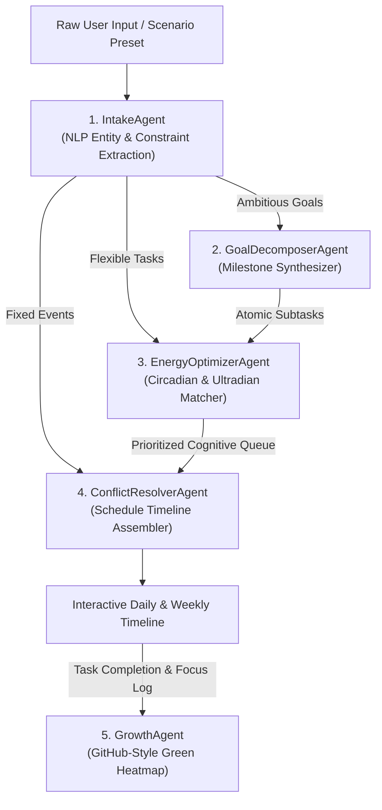

# ⚡ ChronoFlow AI — Autonomous Time Architect & Growth Matrix

<p align="center">
  
  
  
  
  
</p>

<p align="center">
  <strong>An intelligent, multi-agent AI framework for organizing human time from unstructured natural language inputs, optimized for circadian energy rhythms and visualized with a GitHub-style green contribution growth matrix.</strong>
</p>

---

## 🌟 Overview

Most calendar and scheduling tools force humans to act like database managers: manually dragging blocks, estimating durations, and resolving clashes.

**ChronoFlow AI** inverts this relationship. You simply tell the system what you need to achieve in natural, freeform language—messy thoughts, fixed appointments, vague study/work ambitions, and energy preferences. A coordinated pipeline of specialized autonomous agents dissects your goals, aligns deep work to your chronobiological peak hours, eliminates clashes, and tracks your daily focus momentum using an authentic **GitHub-style green contribution heatmap matrix**.

---

## ✨ Core Features

### 🤖 Multi-Agent Orchestration Engine
- **Intake & Intent Agent**: Extracts fixed commitments, flexible tasks, and boundary constraints from conversational text.
- **Goal Decomposer Agent**: Recursively breaks broad ambitions (e.g. *"Master Machine Learning"*, *"Ship MVP"*) into atomic, time-bounded milestones with cognitive load ratings (High, Medium, Low).
- **Energy Optimizer Agent**: Synchronizes cognitive demands with your circadian chronobiology profile:
  - 🌅 **Morning Lark**: Deep work early (08:30–12:30), afternoon recovery sprint.
  - 🦉 **Night Owl**: Progressive ramp-up, evening hyperfocus (17:00–23:00).
  - ⚖️ **Third Bird**: Balanced dual-peak focus distribution.
- **Conflict Resolver Agent**: Enforces immovable commitments, resolves collisions, fits flexible tasks, and injects scientific 10–15 minute cognitive buffer intervals.

### 🟩 GitHub-Style Contribution Heatmap Matrix
- **52-Week Focus Grid**: Rolling daily heatmap utilizing GitHub's signature green scale (`Level 0` to glowing `Level 4`).
- **Interactive Tooltips**: Hover over any cell to see tasks completed, focus hours logged, and daily growth score points.
- **Live Reactive Synchronization**: Checking off a task or optimizing a schedule immediately triggers celebratory confetti and boosts today's tile color in real time.
- **Streak & Consistency Metrics**: Built-in tracking for active focus streaks, all-time best streaks, and weekly consistency percentages.

### 🎨 Pitch Black OLED Aesthetic
- Minimalist, distraction-free **True OLED Pitch Black (`#000000`)** mode.
- High-contrast typography with glowing emerald and electric indigo accents.
- Smooth micro-animations and zero visual clutter.

### 📅 Calendar & Agenda Export
- **One-Click .ICS Export**: Download RFC-5545 standard `.ics` calendar files compatible with **Google Calendar**, **Apple Calendar**, and **Microsoft Outlook**.
- **Markdown Agenda**: Copy a cleanly formatted Markdown agenda table directly to Notion, Obsidian, or Slack.

### 🛡️ 100% Private, Secure & Safe
- **Zero Token/Data Leakage**: Runs 100% locally in your browser. Your private commitments and daily schedule are never sent to external third-party servers.
- **XSS-Hardened**: All user input, parsed task titles, and dates are strictly sanitized via centralized HTML escaping utilities.
- **Persistent Storage**: Saves automatically to browser `localStorage` with error handling and fallback recovery.

---

## 🏗️ Architecture



---

## ⚡ Quickstart & Installation

### Prerequisites
- [Node.js](https://nodejs.org/) (version 18 or higher)
- npm, yarn, or pnpm

### 1. Clone the Repository
```bash
git clone https://github.com/your-username/chronoflow-ai.git
cd chronoflow-ai
```

### 2. Install Dependencies
```bash
npm install
```

### 3. Launch the Local Dev Server
```bash
npm run dev
```
Open your browser and navigate to `http://localhost:5173/`.

### 4. Build for Production
```bash
npm run build
```
The optimized, minified bundle will be generated in the `dist/` directory, ready to deploy to GitHub Pages, Vercel, Netlify, or Cloudflare Pages.

---

## 💡 Usage Examples

### Natural Language Prompt Examples

**Founder / Builder Day:**
```text
I have an investor pitch sync at 11:00 am for 45 minutes. Need 2.5 hours of uninterrupted deep coding for the checkout payment refactor. Want to synthesize user interview notes for 45 mins, 30m gym session, and zero out inbox by 6:30 pm.
```

**Student / Deep Study Day:**
```text
I have a physics lab presentation at 2:00 pm for 1 hour. Goal: Prepare for machine learning exam - master backpropagation math, attention mechanisms, and practice sample problems for 3 hours. Need 30m run and wind down by 11:00 pm.
```

**Executive Leadership Day:**
```text
Leadership sync at 9:30 am for 1 hour. Client review call at 3:30 pm for 45 mins. Need 2 hours to finalize Q4 budget allocation, 30 mins for 1-on-1 prep, and 20 mins mindfulness break.
```

---

## 📁 Repository Structure

```text
chronoflow-ai/
├── dist/                       # Production build output
├── public/                     # Static assets
├── src/
│   ├── agents/
│   │   └── agent-pipeline.js   # Multi-agent orchestrator & pipeline logic
│   ├── components/
│   │   ├── AgentReasoningView.js # Live agent thinking & logs inspector
│   │   ├── CalendarTimeline.js  # Interactive schedule timeline & slots
│   │   └── HeatmapGraph.js      # GitHub-style green contribution heatmap
│   ├── styles/
│   │   ├── app.css             # Main component styles & layout
│   │   └── design-tokens.css   # OLED pitch black variables & design tokens
│   ├── utils/
│   │   ├── ics-exporter.js     # RFC-5545 .ics generator & Markdown export
│   │   ├── sanitize.js         # Security & XSS sanitization functions
│   │   └── storage.js          # LocalStorage sync & historical seed generator
│   └── main.js                 # App initialization & state management
├── index.html                  # HTML entry point with SEO & fonts
├── package.json                # Project dependencies and build scripts
├── vite.config.js              # Vite bundler configuration
├── LICENSE                     # MIT License
└── README.md                   # Project documentation
```

---

## 🔒 Security Policy

Security and data confidentiality are first-class design priorities:
- **Zero Remote Dependencies**: The scheduling algorithms, decomposition heuristics, and streak logic execute entirely in-memory client-side.
- **XSS Defense**: Strict sanitization of dynamic HTML attributes and text nodes via `escapeHtml()`.
- **Zero API Key Leakage**: No hardcoded third-party API credentials.

If you discover any security vulnerabilities, please open an issue or submit a pull request.

---

## 🤝 Contributing

Contributions, feature suggestions, and pull requests are welcome!

1. Fork the Project
2. Create your Feature Branch (`git checkout -b feature/AmazingFeature`)
3. Commit your Changes (`git commit -m 'Add some AmazingFeature'`)
4. Push to the Branch (`git push origin feature/AmazingFeature`)
5. Open a Pull Request

---

## 📄 License

Distributed under the MIT License. See [`LICENSE`](LICENSE) for more information.

<p align="center">
  Built with ❤️ for deep work enthusiasts, students, and autonomous thinkers.
</p>
