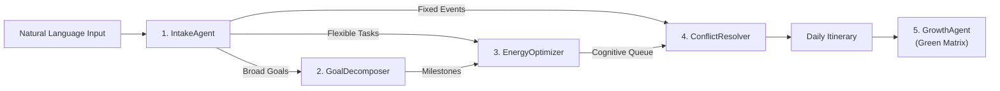

<div align="center">

# ⏱️ ChronoFlow AI

**Autonomous Time Architect & GitHub-Style Growth Matrix**

An intelligent, multi-agent AI system that transforms raw, natural language thoughts into circadian-optimized focus blocks — visualized with a real-time GitHub-style green contribution heatmap.

[](https://vitejs.dev/)
[](https://github.com/SubikshanS/chrono-agent)
[](https://github.com/SubikshanS/chrono-agent)
[](https://github.com/SubikshanS/chrono-agent)
[](LICENSE)

</div>

---

## 💡 Overview

Traditional calendars require tedious manual block-dragging and time estimation. 

**ChronoFlow AI** inverts the workflow: simply paste your stream-of-consciousness plans, fixed meetings, and broad goals. An autonomous pipeline of five specialized agents parses commitments, matches deep work with your biological peak hours, decomposes large goals into atomic steps, and tracks your daily focus growth on a GitHub-style green matrix.

---

## 🤖 Multi-Agent Architecture



| Agent | Role | Function |
| :--- | :--- | :--- |
| 📥 **IntakeAgent** | Entity Extractor | Detects fixed meetings, flexible tasks, deadlines, and wake/sleep windows. |
| 🧩 **GoalDecomposer** | Milestone Synthesizer | Breaks broad goals (*"prepare for exam"*, *"ship MVP"*) into 30–60m atomic subtasks. |
| ⚡ **EnergyOptimizer** | Circadian Matcher | Slots high-cognitive work into personal peak hours (Morning Lark, Night Owl, Third Bird). |
| 🛡️ **ConflictResolver** | Timeline Assembler | Locks non-negotiables, resolves clashes, and injects 10–15m restorative buffers. |
| 🟩 **GrowthAgent** | Habit Tracker | Calculates daily streaks, logs focus hours, and updates the 52-week green matrix. |

---

## ✨ Features

- 🟩 **GitHub-Style Contribution Heatmap**: 52-week productivity matrix using GitHub's signature green scale (`Level 0` to glowing `Level 4`).
- 🌙 **True OLED Pitch Black (`#000000`)**: Ultra-high-contrast, distraction-free aesthetic with glowing neon emerald and electric indigo accents.
- 🎯 **Interactive Timeline Cards**: Check off completed tasks with celebratory particle confetti, shift tasks by +30m, or delete blocks on the fly.
- 📅 **One-Click Calendar Sync**: Export standard RFC-5545 `.ics` files for **Google Calendar**, **Apple Calendar**, and **Outlook**.
- 📋 **Markdown Export**: Copy formatted agenda tables directly to Notion, Slack, or Obsidian.
- 🔒 **100% Private & Secure**: Operates entirely client-side in the browser. Zero tracking, zero telemetry, and XSS-sanitized.

---

## ⚡ Quickstart

### Prerequisites
- [Node.js 18+](https://nodejs.org/)

```bash
# 1. Clone the repository
git clone https://github.com/SubikshanS/chrono-agent.git
cd chrono-agent

# 2. Install dependencies
npm install

# 3. Start local development server
npm run dev
```

Open **`http://localhost:5173/`** in your browser.

---

## 📦 Production Build

```bash
npm run build
```

Generates a minified, production-ready bundle in `dist/` ready to deploy on **Vercel**, **Netlify**, or **GitHub Pages**.

---

## 📂 Project Structure

```text
chrono-agent/
├── src/
│   ├── agents/
│   │   └── agent-pipeline.js    # Multi-agent orchestrator logic
│   ├── components/
│   │   ├── AgentReasoningView.js# Live agent thought inspector
│   │   ├── CalendarTimeline.js  # Interactive schedule & task cards
│   │   └── HeatmapGraph.js      # GitHub-style green contribution matrix
│   ├── styles/
│   │   ├── app.css              # Main component & layout styles
│   │   └── design-tokens.css    # OLED pitch black theme tokens
│   ├── utils/
│   │   ├── ics-exporter.js      # RFC-5545 .ics generator
│   │   ├── sanitize.js          # XSS prevention utilities
│   │   └── storage.js           # LocalStorage state management
│   └── main.js                  # Application controller
├── index.html                   # Entry point
├── package.json                 # Dependencies & scripts
└── LICENSE                      # MIT License
```

---

<details>
<summary><strong>💡 Example Natural Language Prompts (Click to Expand)</strong></summary>

<br>

**🚀 Startup Founder Sprint:**
```text
I have an investor pitch sync at 11:00 am for 45 minutes. Need 2.5 hours of uninterrupted deep coding for the checkout payment refactor. Want to synthesize user interview notes for 45 mins, 30m gym session, and zero out inbox by 6:30 pm.
```

**🎓 Exam Mastery & Study:**
```text
I have a physics lab presentation at 2:00 pm for 1 hour. Goal: Prepare for machine learning exam - master backpropagation math, attention mechanisms, and practice sample problems for 3 hours. Need 30m run and wind down by 11:00 pm.
```

**💼 Executive Leadership:**
```text
Leadership sync at 9:30 am for 1 hour. Client review call at 3:30 pm for 45 mins. Need 2 hours to finalize Q4 budget allocation, 30 mins for 1-on-1 prep, and 20 mins mindfulness break.
```

</details>

---

## 📄 License

Distributed under the [MIT License](LICENSE).
